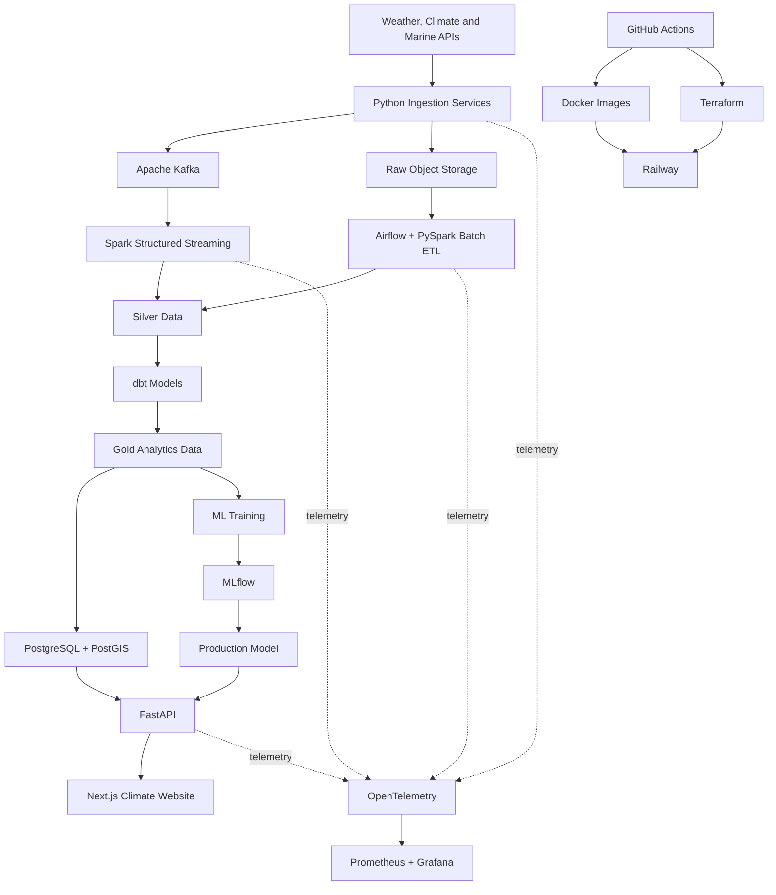

# Architecture overview

A layered, event-driven platform that collects environmental data for Santa Marta,
preserves original source records, transforms them into reliable analytical datasets,
trains and tracks ML models, and serves the results through a public web application.
Ingestion, processing, storage, ML, serving, deployment, and observability are separate
layers so each can evolve independently; raw source records always remain available for
replay, auditing, and reprocessing.

## System diagram



## Data flow

1. **Ingest**: one Python service per external API validates the response structure,
   attaches ingestion metadata, and writes to two destinations: the original payload to
   raw object storage (audit, replay, reprocessing) and an event to Kafka.
2. **Process**: Spark Structured Streaming consumes Kafka events (event-time
   processing, deduplication, schema validation) into the silver layer; Airflow-orchestrated
   PySpark batch jobs handle historical files, partition rebuilds, and backfills.
3. **Model**: silver holds cleaned, normalized, quality-checked records with consistent
   timestamps, units, locations, and sources. dbt transforms silver into gold models for
   application queries, climate analysis, forecast verification, and ML features.
4. **Serve**: gold lands in PostgreSQL/PostGIS for low-latency application and
   geospatial queries; larger analytical datasets stay in Parquet in object storage.
   FastAPI combines stored data and model predictions into versioned endpoints consumed
   by the Next.js site.
5. **Learn**: ML pipelines train on versioned gold datasets, log everything to MLflow,
   and promote models through the MLflow Registry into the prediction service.
6. **Operate**: Docker images deployed via GitHub Actions, infrastructure provisioned
   with Terraform, hosted on Railway; OpenTelemetry feeds Prometheus and Grafana.

## Component responsibilities

Each component has one job, and an explicit boundary it must not cross.

| Component | Responsible for | Must not |
| --- | --- | --- |
| External APIs | Observations, forecasts, historical and environmental data | Be trusted blindly: schemas, units, availability are validated before use |
| Python ingestion services | One source each: fetch, source-level validation, request metadata, persist/publish | Contain analytical logic, feature engineering, or app transformations |
| Apache Kafka | Event delivery and replay for time-sensitive records | Act as scheduler, analytical database, or object-storage replacement |
| Raw object storage | Immutable source payloads + ingestion metadata (JSON/Parquet); recovery and audit layer | Be queried directly by the public application |
| Spark Structured Streaming | Continuous processing: event time, checkpoints, dedup, streaming aggregations | Serve API requests or replace lightweight Python transformations |
| Airflow | Scheduling and dependencies for batch pipelines, backfills, quality checks | Transport streaming events or perform transformations itself |
| PySpark batch ETL | Historical processing, large joins, reproducible bronze→silver rebuilds | Be used where data volume doesn't justify it |
| Silver layer | Canonical normalized, deduplicated, quality-checked records | Contain presentation summaries or model predictions |
| dbt Core | Documented, tested SQL models from silver to gold; warehouse lineage | Ingest, stream, or train models |
| Gold layer | Application- and analysis-ready models (conditions, summaries, verification, ML features) | Contain manually edited records |
| PostgreSQL + PostGIS | Low-latency operational and spatial queries | Store every raw payload or large historical file |
| Parquet storage | Large historical, intermediate, and ML-ready tables | Replace the transactional database behind the API |
| ML training | Features, time-aware splits, baselines, training, evaluation | Modify source data or self-declare production eligibility |
| MLflow | Experiments, metrics, artifacts, code versions, registry stages | Replace the training pipeline, feature store, or monitoring |
| Production model | Approved predictions (corrections, risk, anomalies) | Use future information or training-only transformations |
| FastAPI | Versioned endpoints, validation, caching, authorization | Run heavy ETL or train models during requests |
| Next.js website | Presentation: conditions, forecasts, maps, methodology | Compute authoritative metrics or reach internal databases directly |
| GitHub Actions | CI/CD: tests, quality and security checks, builds, deployment | Host long-running application workloads |
| Docker | Reproducible service images | Replace provisioning, persistent storage, or orchestration |
| Terraform | Infrastructure, managed services, and environments as code | Contain business logic or committed secrets |
| Railway | Runtime hosting for deployed services | Hold the data lake or production Kafka (external managed services) |
| OpenTelemetry | Vendor-neutral traces, metrics, telemetry collection | Store business data or replace data-quality checks |
| Prometheus + Grafana | Operational metrics, dashboards, alerts | Become the source of truth for climate data |

## Environments

### Local

Docker Compose runs PostgreSQL/PostGIS, Kafka, MinIO (S3-compatible object storage),
Redis, Airflow, and MLflow; the API and website run alongside for development and
integration testing. External sources may be called directly, but recorded fixtures and
mocks should exist for deterministic tests.

```bash
make setup
make dev
make test
```

Local may use reduced data volumes, shorter retention, and simplified authentication,
but it keeps the same schemas, contracts, and transformation behavior as staging and production.

### Staging

Validates changes under production-like conditions using the **same** Docker images,
Terraform modules, migrations, event schemas, and deployment process as production,
with smaller plans, reduced retention, limited historical data, and separate
credentials. It should hit real external sources where practical so schema changes,
latency, and rate limits surface before production.

Every staging deployment runs: database migrations, ingestion smoke tests, API health
checks, data-contract validation, sample ETL execution, model-loading tests, website
end-to-end tests, and Terraform/security checks. Staging data stays fully isolated from
production (topics, buckets, databases, MLflow experiments, credentials).

### Production

Hosts the public service and collects data continuously. Immutable Docker images
deployed through GitHub Actions, provisioned by Terraform; persistent PostgreSQL and
Redis, durable object storage, production Kafka, Airflow and Spark workloads, MLflow,
and centralized observability. Only changes tested in staging are promoted; migrations,
infrastructure changes, and model promotions use explicit approval gates and support
rollback.

Production enforces: separate secrets, persistent backups, retention policies,
source-freshness monitoring, dead-letter handling, model and deployment version
tracking, health/readiness checks, operational alerts, controlled migrations, and
reproducible historical reprocessing.

When an upstream source fails, the public application degrades gracefully: cached data
may remain visible, but every response exposes its source and last-update timestamp;
stale values are never presented as current.
