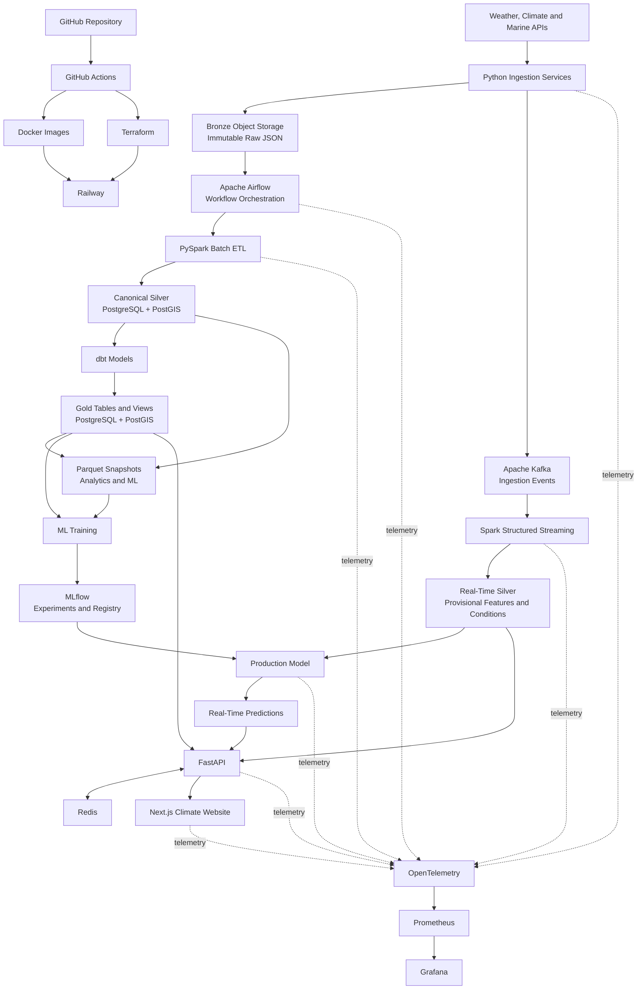

# Architecture overview

A layered, event-driven platform that collects environmental data for Santa Marta,
preserves original source records, transforms them into reliable analytical datasets,
trains and tracks ML models, and serves the results through a public web application.
Ingestion, processing, storage, ML, serving, deployment, and observability are separate
layers so each can evolve independently; raw source records always remain available for
replay, auditing, and reprocessing.

The platform uses a **hybrid medallion architecture**: medallion (bronze/silver/gold)
is the logical data-quality model, not a storage prescription. Object storage holds
immutable raw data, PostgreSQL/PostGIS holds cleaned, queryable time-series and
geospatial data, and Parquet holds large analytical datasets, historical snapshots, and
ML training data.

## System diagram



## Data flow

1. **Ingest**: one Python service per external API validates the response structure,
   attaches ingestion metadata, and writes to two destinations: the original payload
   (compressed JSON, plus request metadata and payload hash) to raw object storage, and
   an event to Kafka.
2. **Process**: Spark Structured Streaming consumes Kafka events and upserts normalized
   records into silver tables in PostgreSQL; unique constraints make the upserts
   idempotent. Airflow-orchestrated PySpark batch jobs read raw JSON from object
   storage for backfills, rebuilds, and late corrections. Corrections enter only as
   newly ingested raw records, never as manual UPDATEs, so silver stays reproducible
   from the raw layer.
3. **Model**: silver tables in Postgres are the canonical cleaned dataset: standard
   units, UTC timestamps, station mapping, quality flags, dedup. dbt transforms silver
   into gold entirely inside Postgres (tables, views, materialized views) for
   application queries, climate analysis, and forecast verification.
4. **Serve**: the API reads gold in Postgres only. PostGIS answers spatial queries;
   Redis caches safe responses.
5. **Analyze and learn**: deterministic export jobs write dated, versioned Parquet
   snapshots of silver and gold to object storage for Jupyter exploration, Spark
   processing, and ML training. ML pipelines train from those snapshots (and Postgres
   where convenient), log to MLflow, and promote models through the MLflow Registry
   into the prediction service.
6. **Operate**: Docker images deployed via GitHub Actions, infrastructure provisioned
   with Terraform, hosted on Railway; OpenTelemetry feeds Prometheus and Grafana.

## What lives where

| Layer | Primary storage | Purpose |
| --- | --- | --- |
| Raw | Object storage, compressed JSON | Exact source preservation; never deleted |
| Bronze | Object storage, JSON or Parquet | Validated ingestion records (payload, request metadata, hash) |
| Silver | PostgreSQL/PostGIS (TimescaleDB optional) | Canonical cleaned data: the working system of record |
| Gold serving | PostgreSQL tables and materialized views | Fast API and website queries |
| Gold analytics | Versioned Parquet in object storage | Exploration, Spark, and ML |
| Events | Kafka | Transport and replay, not permanent storage |
| ML artifacts | Object storage through MLflow | Models, plots, experiment artifacts |

Storage rules:

- PostgreSQL is the working system of record for normalized data. Parquet datasets are
  dated, derived snapshots produced by deterministic export jobs; they are never edited
  in place, and when they diverge from Postgres, Postgres is canonical.
- Raw JSON is never deleted. A bronze Parquet copy may exist for efficient bulk
  processing, but it is a derived convenience, not a replacement.
- Silver and gold can always be dropped and rebuilt from the raw/bronze layer.
- Silver benefits from database behavior Parquet cannot give: unique constraints,
  upserts, transactions, corrections for late-arriving data, time-range and spatial
  queries. This is why silver is a database, and why an all-Parquet medallion was
  rejected (see the corresponding ADR).
- TimescaleDB (hypertables, continuous aggregates) and Apache Iceberg are deliberate
  deferrals: adopt them only when they fix a real limitation this design has hit.

Physical layout of object storage:

```text
raw/
├── open_meteo/
├── metar/
├── ideam/
└── nasa_power/
parquet/
├── silver_exports/
├── gold_features/
├── forecast_verification/
└── climate_aggregates/
mlflow/
├── experiments/
└── models/
```

PostgreSQL schemas: `metadata` (sources, ingestion runs, locations, stations),
`silver` (observations, forecasts, marine, air quality, quality results), `gold`
(current conditions, summaries, forecast accuracy, climatology).

## Component responsibilities

Each component has one job, and an explicit boundary it must not cross.

| Component | Responsible for | Must not |
| --- | --- | --- |
| External APIs | Observations, forecasts, historical and environmental data | Be trusted blindly: schemas, units, availability are validated before use |
| Python ingestion services | One source each: fetch, source-level validation, request metadata, persist/publish | Contain analytical logic, feature engineering, or app transformations |
| Apache Kafka | Event delivery and replay for time-sensitive records | Act as scheduler, analytical database, or object-storage replacement |
| Raw object storage | Immutable source payloads + ingestion metadata; recovery and audit layer | Be queried directly by the public application; ever delete raw JSON |
| Spark Structured Streaming | Kafka consumption into Postgres silver via idempotent upserts (foreachBatch) | Serve API requests or replace lightweight Python transformations |
| Airflow | Scheduling and dependencies for batch pipelines, backfills, quality checks | Transport streaming events or perform transformations itself |
| PySpark batch ETL | Backfills from raw JSON, large joins, historical rebuilds | Be used where data volume doesn't justify it |
| Silver (PostgreSQL) | Canonical normalized, deduplicated, quality-checked records with constraints | Be edited manually; accept corrections that bypass raw-layer ingestion |
| dbt Core | Documented, tested SQL models from silver to gold inside Postgres | Ingest, stream, or train models |
| Gold serving (PostgreSQL) | Application-ready tables and materialized views (conditions, summaries, verification) | Contain manually edited records |
| Gold analytics (Parquet) | Dated, versioned snapshots for exploration, Spark, and ML | Be edited in place or treated as canonical over Postgres |
| PostGIS | Spatial types, indexes, and geographic queries | Duplicate analytical modeling that belongs in dbt |
| ML training | Features, time-aware splits, baselines, training, evaluation | Modify source data or self-declare production eligibility |
| MLflow | Experiments, metrics, artifacts, code versions, registry stages | Replace the training pipeline, feature store, or monitoring |
| Production model | Approved predictions (corrections, risk, anomalies) | Use future information or training-only transformations |
| FastAPI | Versioned endpoints, validation, caching, authorization; reads gold only | Run heavy ETL or train models during requests |
| Next.js website | Presentation: conditions, forecasts, maps, methodology | Compute authoritative metrics or reach internal databases directly |
| GitHub Actions | CI/CD: tests, quality and security checks, builds, deployment | Host long-running application workloads |
| Docker | Reproducible service images | Replace provisioning, persistent storage, or orchestration |
| Terraform | Infrastructure, managed services, and environments as code | Contain business logic or committed secrets |
| Railway | Runtime hosting for deployed services | Hold the data lake or production Kafka (external managed services) |
| OpenTelemetry | Vendor-neutral traces, metrics, telemetry collection | Store business data or replace data-quality checks |
| Prometheus + Grafana | Operational metrics, dashboards, alerts | Become the source of truth for climate data |

## Environments

### Local

Docker Compose runs PostgreSQL/PostGIS, Kafka, MinIO (S3-compatible object storage),
Redis, Airflow, and MLflow; the API and website run alongside for development and
integration testing. External sources may be called directly, but recorded fixtures and
mocks should exist for deterministic tests.

```bash
make setup
make dev
make test
```

Local may use reduced data volumes, shorter retention, and simplified authentication,
but it keeps the same schemas, contracts, and transformation behavior as staging and production.

### Staging

Validates changes under production-like conditions using the **same** Docker images,
Terraform modules, migrations, event schemas, and deployment process as production,
with smaller plans, reduced retention, limited historical data, and separate
credentials. It should hit real external sources where practical so schema changes,
latency, and rate limits surface before production.

Every staging deployment runs: database migrations, ingestion smoke tests, API health
checks, data-contract validation, sample ETL execution, model-loading tests, website
end-to-end tests, and Terraform/security checks. Staging data stays fully isolated from
production (topics, buckets, databases, MLflow experiments, credentials).

### Production

Hosts the public service and collects data continuously. Immutable Docker images
deployed through GitHub Actions, provisioned by Terraform; persistent PostgreSQL and
Redis, durable object storage, production Kafka, Airflow and Spark workloads, MLflow,
and centralized observability. Only changes tested in staging are promoted; migrations,
infrastructure changes, and model promotions use explicit approval gates and support
rollback.

Production enforces: separate secrets, persistent backups, retention policies,
source-freshness monitoring, dead-letter handling, model and deployment version
tracking, health/readiness checks, operational alerts, controlled migrations, and
reproducible historical reprocessing.

When an upstream source fails, the public application degrades gracefully: cached data
may remain visible, but every response exposes its source and last-update timestamp;
stale values are never presented as current.
