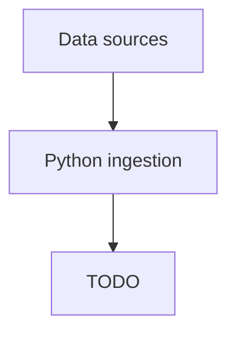

# Architecture overview

<!-- TODO: replace the placeholder below with the real system diagram and a prose
     walkthrough of the data flow: sources → ingestion → raw lake + Kafka →
     bronze/silver/gold → PostGIS + Parquet → ML/MLflow → FastAPI → website. -->

## System diagram

## Component responsibilities

<!-- TODO: one short paragraph per component explaining its single job and what it
     must NOT be used for (e.g. Kafka handles events, not scheduling). -->

## Environments

<!-- TODO: local / staging / production — what runs where, and what is mocked or
     external in each. -->
